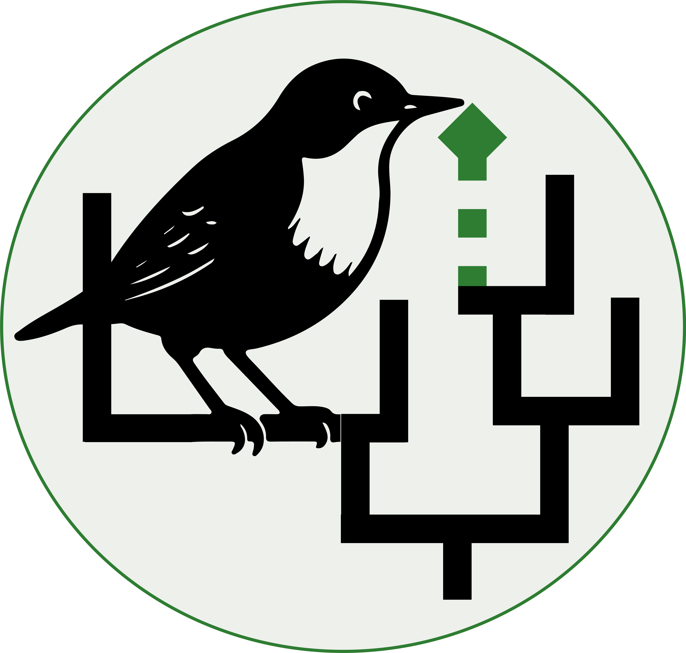

<div align="center">

# DIPPER: Distance-based Phylogenetic Placer

[license-badge]: https://img.shields.io/badge/License-MIT-yellow.svg 
[license-link]: https://github.com/TurakhiaLab/DIPPER/blob/main/LICENSE

[](https://doi.org/10.1038/s43588-026-01015-8)
[](https://cmake.org)
[](https://hub.docker.com/r/swalia14/dipper)
[](https://zenodo.org/records/17259722)
[](https://www.youtube.com/watch?v=j_Atot3itu4)
[](https://github.com/TurakhiaLab/dipper/actions)

<div align="center">
  
</div>

</div>

## What's New

- **DIPPER v0.1.5**
  - **Protein sequences:** DIPPER supports reconstruction of phylogenies from protein sequences (unaligned and aligned).
  - **CPU-only support:** DIPPER now builds on CPU-only systems (Linux and MacOS). 

## Table of Contents
- [Introduction](#intro) ([Wiki](https://turakhia.ucsd.edu/DIPPER/))
- [Installation](#install)
  <!-- - [Summary](#summary)  -->
  - [Using Conda (Recommended)](#conda)
  - [Using Docker Image](#dockerimage)
  - [Using Dockerfile](#dockerfile)
  - [Using Installation Script](#script)
- [Run DIPPER](#run)
  - [De-novo](#denovo)
    - [Using default mode](#default)
    - [Using placement technique](#place)
    - [Using divide-and-conquer technique](#dc)
  - [Adding tips to a backbone tree](#add)
  - [Protein sequence support](#protein)
  - [Reproduce DIPPER results](#reproduce)
- [Contributions](#contribution)
- [Citing DIPPER](#cite)

## <a name="intro"></a> Introduction

DIPPER (**DI**stance-based **P**hylogenetic **P**lac**ER**) is a tool for ultrafast and ultralarge phylogenetic reconstruction on GPUs, designed to maintain high accuracy with a minimal memory footprint. DIPPER introduces several innovations, including a divide-and-conquer strategy, a new placement algorithm, and an on-the-fly distance calculator that dynamically enables selective distance computation. DIPPER consistently outperforms existing distance-based methods in speed, accuracy, and memory efficiency. In addition, DIPPER minimizes branch length underestimation for non-additive distance matrices compared to earlier methods and offers a strict mode that completely eliminates the underestimation. 

## <a name="install"></a> Installation
DIPPER runs on modern Linux and macOS systems, supporting NVIDIA (CUDA) and AMD (HIP/ROCm) GPUs as well as CPU-only execution. Users may choose the installation method suitable for their requirements.

| Platform / Setup       | [Conda](#conda) | [Script](#script) | [Docker](#docker) |
|------------------------|-----------------|-------------------|-------------------|
| Linux (x86_64)         | ✅               | ✅                | ✅                |
| Linux (aarch64)        | ✅               | ✅                | ✅                |
| macOS (Intel Chip)     | ✅               | ✅                | ✅                |
| macOS (Apple Silicon)  | ✅               | ✅                | ✅                |
| NVIDIA GPU             | ✅               | ✅                | ✅                |
| AMD GPU                | ❌               | ✅                | ❌                |

### 1. <a name="conda"></a> Using Conda (Recommended)
DIPPER is available on multiple platforms via Conda. See [DIPPER Bioconda Page](https://anaconda.org/bioconda/dipper) for details.

#### i. Dependencies
1. [Conda](https://docs.conda.io/en/latest/)

#### ii. Create and activate a Conda environment
```bash
conda create -n dipper python=3.11 -y
conda activate dipper
# Set up channels
conda config --add channels defaults
conda config --add channels bioconda
conda config --add channels conda-forge
conda config --set channel_priority strict
# Install DIPPER
conda install bioconda::dipper
conda install bioconda::dipper_cpu # CPU-only
```

#### iii. Run DIPPER
```bash
# Inside the conda environment
dipper --help
# dipper_cpu --help # CPU-only
```

### 2. <a name="dockerimage"></a> Using Docker Image
To run DIPPER in Docker, create a container from the image by following these steps.
#### i. Dependencies
1. [Docker](https://docs.docker.com/engine/install/)
#### ii. Pull and build the DIPPER Docker image from Docker Hub
```bash
## Note: If the Docker image already exists locally, make sure to pull the latest version using 
## docker pull swalia14/dipper:latest # (NVIDIA-GPUs)
## docker pull swalia14/dipper_cpu:latest # (CPU-only)

## If the Docker image does not exist locally, the following command will pull and run the latest version
docker run -it --gpus all swalia14/dipper:latest # (NVIDIA-GPUs)
docker run -it swalia14/dipper_cpu:latest # (CPU-only)

```
#### iii. Run DIPPER
```bash
# Inside the Docker container (path: /home/DIPPER/bin)
dipper --help
# dipper_cpu --help # CPU-only
```

### 3. Using Dockerfile <a name="dockerfile"></a>
A Docker container with the preinstalled DIPPER program can also be built from a Dockerfile by following these steps.

#### i. Dependencies
1. [Docker](https://docs.docker.com/engine/install/)
2. [Git](https://git-scm.com/downloads)

#### ii. Clone the repository and build a Docker image
```bash
git clone https://github.com/TurakhiaLab/DIPPER.git
cd DIPPER/docker
docker build -t dipper -f  Dockerfile . 
docker build -t dipper -f  Dockerfile_cpu . # CPU-only 
```
#### iii. Build and run the Docker container
```bash
docker run -it --gpus all dipper
```
#### iv. Run DIPPER
```bash
# Inside the Docker container (path: /home/DIPPER/bin)
./dipper --help
# dipper_cpu --help # CPU-only
```

### 4. <a name="script"></a> Using installation script (requires sudo access)  

Users without sudo access are advised to install DIPPER via [Docker Image](#dockerimage) or [Dockerfile](#dockerfile).

**Step 1:** Clone the repository
```bash
git clone https://github.com/TurakhiaLab/DIPPER.git
cd DIPPER
```
**Step 2:** Install dependencies (requires sudo access)

DIPPER depends on the following common system libraries, which are typically pre-installed on most development environments:
```bash
- wget
- cmake 
- build-essential 
- libboost-all-dev
- libtbb-dev
```
For Ubuntu users with sudo access, if any of the required libraries are missing, you can install them with:
```bash
sudo apt install -y wget cmake build-essential libboost-all-dev  libtbb-dev
```

**Step 3:** Build DIPPER

```bash
cd install
chmod +x installUbuntu.sh
./installUbuntu.sh
cd ../
```

**Step 4:** The DIPPER executable is located in the `bin` directory and can be run as follows:
```bash
cd bin
./dipper --help
```

## <a name="run"></a> Run DIPPER
For more information about DIPPER's options and instructions, see [wiki](https://turakhia.ucsd.edu/DIPPER/) for more details. 

<b>Note:</b> All the files in the examples below can be found in the `DIPPER/dataset`. 

<div style="background-color: #e8f5e9; padding: 0.5em; border-radius: 4px;">
  To execute <strong>DIPPER CPU version</strong>, replace
  <code>./dipper</code> with <code>./dipper_cpu</code>
  in the following commands.
</div><br>

Enter into the bin directory (assuming `$DIPPER_HOME` directs to the DIPPER repository directory). For the Docker container `$DIPPER_HOME` is `/home/DIPPER/bin`   
```bash
cd $DIPPER_HOME/bin
./dipper -h
```
### De-novo phylogeny construction <a name="denovo"></a>
DIPPER supports de-novo construction of phylogenies from unaligned/aligned sequences in FASTA format and distance matrix in PHYLIP format. 

#### Default mode <a name="default"></a>
In default mode, DIPPER constructs phylogeny using:
1. Conventional NJ for sequences/tips < 30,000
2. Placement technique for sequences/tips >= 30,000 and < 1,000,000
3. Divide-and-conquer technique for sequences/tips >= 1,000,000

##### From unaligned sequences
Usage syntax
```bash
./dipper -i r -o t -I <path to unaligned sequences FASTA file> -O <path to output file>
```
Example
```bash
./dipper -i r -o t -I ../dataset/t2.unaligned.fa -O tree.nwk
```

##### From aligned sequences
Usage syntax (using JC model)
```bash
./dipper -i m -o t -d 2 -I <path to aligned sequences FASTA file> -O <path to output file>
```
Example
```bash
./dipper -i m -o t -d 2 -I ../dataset/t1.aligned.fa -O tree.nwk
```

##### From distance matrix
Usage syntax 
```bash
./dipper -i d -o t -I <path to distance matrix PHYLIP file> -O <path to output file>
```
Example
```bash
./dipper -i d -o t -I ../dataset/t2.phy -O tree.nwk
```

#### Construct phylogeny using placement technique <a name="place"></a>
DIPPER allows users to construct phylogeny using the forced placement technique by setting the `-m` option to `1`. Below we provide a syntax and an example for input unaligned sequences, but DIPPER also supports aligned sequences and distance matrix as input.
Usage syntax
```bash
./dipper -i r -o t -m 1 -I <path to unaligned sequences FASTA file> -O <path to output file>
```
Example
```bash
./dipper -i r -o t -m 1 -I ../dataset/t2.unaligned.fa -O tree.nwk
```

#### Construct phylogeny using divide-and-conquer technique <a name="dc"></a>
DIPPER allows users to construct phylogeny using the forced divide-and-conquer technique by setting the `-m` option to `3`. Below we provide a syntax and an example for input unaligned sequences, but DIPPER also supports aligned sequences and distance matrix as input.
Usage syntax
```bash
./dipper -i r -o t -m 3 -I <path to unaligned sequences FASTA file> -O <path to output file>
```
Example
```bash
./dipper -i r -o t -m 3 -I ../dataset/t2.unaligned.fa -O tree.nwk
```

### Adding tips (sequences) to a backbone tree <a name="add"></a>
DIPPER allows users to add tips to an existing backbone tree using the placement technique. It requires tip sequences from the backbone tree and input query sequences to be provided in a single file (FASTA format), along with the input tree in Newick format.

Usage syntax 
```bash
./dipper -i r -o t -m 1 --add -I <path to unaligned/aligned sequences FASTA file (containing backbone tree tip sequences and query sequences)> -O <path to output file> -t <path to input tree>
```
Example
```bash
./dipper -i r -o t -m 1 --add -I ../dataset/t2.unaligned.fa -O tree.nwk -t ../dataset/backbone.nwk
```


### Protein sequence support <a name="protein"></a>
DIPPER supports ultrafast reconstruction of phylogenies from protein sequences (both unaligned and aligned). Pass `-p` (or `--protein`) to enable protein mode.

#### 1. Aligned protein sequences (`-i m`)
For aligned protein sequences, DIPPER supports the following evolutionary distance metrics:
* `-d 2` (**Default**): **Kimura protein empirical distance** based on Dayhoff's model.
* `-d 1`: **Uncorrected $p$-distance**.

*(Note: DNA-specific nucleotide models `-d 3` through `-d 6` such as Tajima-Nei, K2P, Tamura, and Jin-Nei are not applicable to proteins and will raise an error).*

Usage syntax:
```bash
# Default (Kimura protein distance)
./dipper -p -i m -o t -I <path to aligned protein sequences FASTA file> -O <path to output file>

# Explicitly specifying distance type (1: Uncorrected, 2: Kimura default)
./dipper -p -i m -o t -d 2 -I <path to aligned protein sequences FASTA file> -O <path to output file>

# CPU execution with multi-threading (e.g. 16 threads)
./dipper_cpu -p -i m -o t -d 2 -T 16 -I <path to aligned protein sequences FASTA file> -O <path to output file>
```

##### Gappy Column Trimming (`--trim-gaps`)
In aligned mode (`-i m`), MSA files often contain sparse columns that consist almost entirely of gaps. DIPPER includes an optimized pre-filtering feature:
* `--trim-gaps <float>` (default: `0.99`): Automatically removes columns with gap proportions $\ge \text{threshold}$ (e.g., $\ge 99\%$ gaps) before compression and distance calculation. This accelerates tree building by 1.5x–3x on large, sparse alignments without loss of topological accuracy.
* `--no-trim`: Disables gap trimming and retains all alignment columns.

```bash
# Custom gap trimming threshold (e.g., trim columns with >= 95% gaps)
./dipper -p -i m -o t --trim-gaps 0.95 -I <aligned.fa> -O <tree.nwk>

# Disable gap trimming completely
./dipper -p -i m -o t --no-trim -I <aligned.fa> -O <tree.nwk>
```

#### 2. Unaligned protein sequences (`-i r`)
For unaligned protein sequences, DIPPER constructs MinHash sketches and computes Mash $k$-mer Jaccard distances directly from amino acid sequences.

##### Amino Acid Alphabet Options (GPU & CPU)
By default, DIPPER uses a **4-group 2-bit Dayhoff reduced alphabet** (`L`=LVIMC, `A`=AGSTP, `F`=FYW, `E`=EDNQKRH) for unaligned protein sequences. This maps conservative substitutions to the same token, reduces state space from $20^{15}$ to $4^{15}$, and aligns with DIPPER's default $k=15$.

* **Default** (Reduced 4-group): 4-group Dayhoff alphabet with 2-bit encoding (supports $k \le 32$).
* `--protein-full`: Full 20-amino-acid alphabet with 8-bit encoding. (Recommended with a smaller $k$-mer size, e.g. `-k 6` or `-k 7`).
* `--protein-murphy8` (or `--murphy8`): 8-state Murphy reduced alphabet with 3-bit encoding (`L`=LVIMC, `A`=AG, `S`=ST, `F`=FYW, `E`=EDNQ, `K`=KRH, `P`=P, `X`=unknown, supports $k \le 21$).

Usage syntax:
```bash
# Default (4-group reduced alphabet, k=15)
./dipper -p -i r -o t -I <path to unaligned protein sequences FASTA file> -O <path to output file>
./dipper_cpu -p -i r -o t -T 16 -I <path to unaligned protein sequences FASTA file> -O <path to output file>

# Using Murphy8 reduced alphabet
./dipper -p -i r -o t --protein-murphy8 -I <unaligned.fa> -O <tree.nwk>
./dipper_cpu -p -i r -o t --protein-murphy8 -T 16 -I <unaligned.fa> -O <tree.nwk>

# Using full 20-amino-acid alphabet (with smaller k-mer size)
./dipper -p -i r -o t --protein-full -k 7 -I <unaligned.fa> -O <tree.nwk>
./dipper_cpu -p -i r -o t --protein-full -k 7 -T 16 -I <unaligned.fa> -O <tree.nwk>
```

Example:
```bash
./dipper -p -i m -o t -m 1 -I ../dataset/t3.aligned.fa -O tree.nwk
```

### Reproduce DIPPER results <a name="reproduce"></a>
To reproduce DIPPER results provided here: [https://zenodo.org/records/17259722](https://zenodo.org/records/17259722), follow the instructions provided in [scripts/reproduce_results.sh](https://github.com/TurakhiaLab/DIPPER/blob/main/scripts/reproduce_results.sh)

##  <a name="contribution"></a> Contributions
We welcome contributions from the community to enhance the capabilities of **DIPPER**. If you encounter any issues or have suggestions for improvement, please open an issue on the [DIPPER GitHub page](https://github.com/TurakhiaLab/DIPPER/issues). For general inquiries and support, reach out to our team.

##  <a name="cite"></a> Citing DIPPER
If you use DIPPER in your research or publications, we kindly request that you cite the following paper: 
* Sumit Walia, Zexing Chen, Yu-Hsiang Tseng, Yatish Turakhia, "<i>Ultrafast and Ultralarge Distance-Based Phylogenetics Using DIPPER</i>", Nature Computational Science (2026). [https://doi.org/10.1038/s43588-026-01015-8](https://doi.org/10.1038/s43588-026-01015-8)
